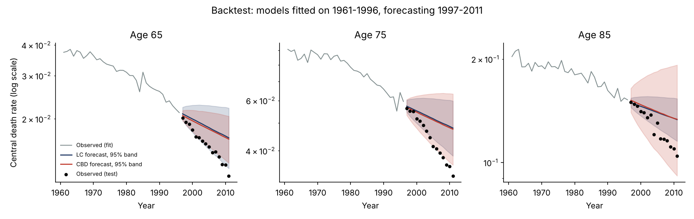
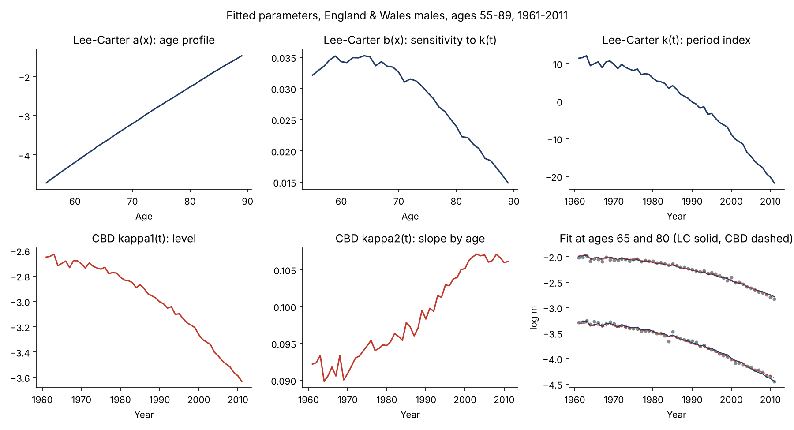
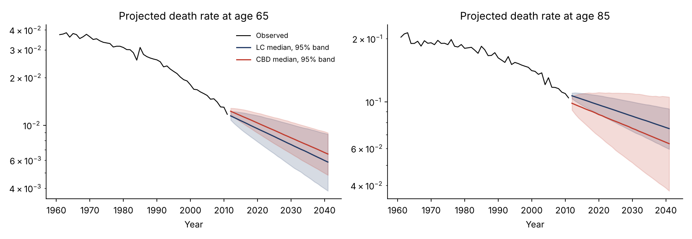
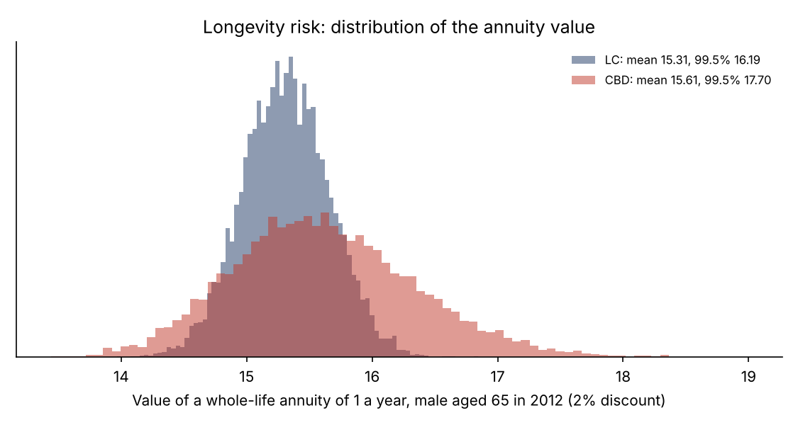

# Longevity Risk with Stochastic Mortality Models: Lee-Carter vs Cairns-Blake-Dowd

[](https://github.com/yelbakali-creator/longevity-risk-stochastic-mortality/actions/workflows/tests.yml)

A from-scratch Python study of longevity risk on real data (England & Wales males, ages 55-89, 1961-2011, Human Mortality Database):

1. **Two stochastic mortality models**, fitted by Poisson maximum likelihood: Lee-Carter (Brouhns, Denuit & Vermunt, 2002) and Cairns-Blake-Dowd (2006).
2. **Out-of-sample backtest**: calibrate on 1961-1996, forecast 1997-2011, compare with what actually happened.
3. **Stochastic projections** with both process noise and drift (parameter) uncertainty, 10,000 scenarios.
4. **Applications**: cohort life expectancy, annuity values, longevity capital versus the Solvency II standard formula, and an indicative longevity swap premium.

## Key results

| | Lee-Carter | CBD |
|---|---|---|
| Cohort life expectancy at 65 (male aged 65 in 2012) | 19.7 years (99% range 18.4 - 21.1) | 20.3 years (99% range 17.6 - 24.0) |
| Annuity value at 65, 2% discount: mean / 99.5% | 15.31 / 16.19 | 15.61 / 17.70 |
| Stochastic run-off longevity capital (99.5%) | 5.7% | 13.4% |
| Solvency II standard formula (20% fall in mortality rates) | 7.5% | 8.1% |
| Longevity swap premium, cost of capital 6% / 4.75% | 3.7% / 2.9% | 9.0% / 7.1% |

Period life expectancy at 65 in 2011 is 18.2 years, so cohort life expectancy, which allows for future improvements, adds 1.5 to 2.1 years.

## The backtest: the core lesson of longevity risk



| Model | Share of observations in the 95% band | Share below the band | Mean log error |
|---|---|---|---|
| Lee-Carter | 58.1% | 41.5% | -0.132 |
| CBD | 70.9% | 29.1% | -0.137 |

Both models, calibrated on 1961-1996, **under-predicted the improvement of the 2000s**: actual death rates ended up about 12% below the central forecast on average, and many observations fell below the 95% band. This is precisely longevity risk: the trend itself changes, and a model calibrated on the past cannot see it coming. CBD's wider bands covered reality better than Lee-Carter's.

## Model fit



| Model | Log-likelihood | Parameters | BIC |
|---|---|---|---|
| Lee-Carter, Poisson MLE | -15,163.8 | 119 | 31,218.5 |
| Lee-Carter, SVD (original method) | -15,637.7 | 119 | n/a |
| CBD, Poisson MLE | -17,621.1 | 102 | 36,005.8 |

Both models are fitted under the same Poisson likelihood for deaths (for CBD, m = -log(1 - q)), so their likelihoods and BIC are directly comparable.

- **Lee-Carter fits better in-sample** on ages 55-89, and Poisson maximum likelihood clearly beats the original SVD fit.
- **CBD is more robust out of sample.** Its central forecast is no more accurate than Lee-Carter's (similar mean errors), but its uncertainty bands covered reality much better (71% vs 58%). Its two period factors let the level and the age slope of mortality move independently: kappa2 rises over time, so improvement has been faster at younger pension ages than at the oldest ages. Lee-Carter's single factor forces all ages to move together, which **understates uncertainty**. This is why its capital (5.7%) is less than half of CBD's (13.4%).

**Numerical check.** At the Poisson maximum likelihood, the score equation for a(x) implies that fitted deaths equal observed deaths for every age. The fit satisfies this to a relative precision of 5e-10.

## Projections and capital





- **Stochastic capital** is the 99.5% quantile of the annuity value in excess of its mean, on a run-off basis.
- **Standard formula capital** applies a permanent 20% fall in mortality rates to the central projection.

The standard formula (7.5-8.1%) sits between the two models' stochastic results. Model choice alone moves the capital by a factor of more than 2: model risk is itself a major part of longevity risk.

**Longevity swap premium.** The fixed leg is priced by the cost-of-capital method, as for the Solvency II risk margin. The capital runs off with the best-estimate liability and is charged at 6% (and 4.75% as a sensitivity). The premium is expressed as a loading on expected payments.

## Method notes

- **Lee-Carter:** log m(x,t) = a(x) + b(x) k(t), constraints sum b(x) = 1 and sum k(t) = 0. Newton-Raphson updates of the Poisson likelihood, started from the SVD solution.
- **CBD:** logit q(x,t) = kappa1(t) + kappa2(t)(x - x_bar), fitted year by year.
- **Projection:** k(t) follows a random walk with drift. (kappa1, kappa2) follows a bivariate random walk with drift and correlated shocks. The drift of each scenario is drawn from its estimation distribution.
- **Ages above 89:** log-linear extrapolation in age for Lee-Carter. CBD extrapolates naturally through its logit-linear age structure.
- **Applications:** survival curves follow the cohort diagonal of each simulated rate surface; annuities are paid annually in arrears.

## Limitations and next steps

- **Run-off versus one-year view.** Capital here is a run-off measure, which overstates a Solvency II one-year SCR. The swap premiums are therefore upper bounds; market pricing would use a one-year capital measure.
- **Jump-off bias.** CBD's projection at age 65 starts slightly above the last observed rate, because a two-factor model cannot fit every age exactly. Production models often anchor projections on observed rates.
- **Cohort effects.** UK data show strong cohort effects (around the 1925-1945 generations). Next steps: Renshaw-Haberman, CBD M7 and the age-period-cohort model.
- **Basis risk.** National population mortality differs from an insured or pension portfolio, which matters for index-based longevity hedges.
- **Discounting:** a flat 2% rate; a yield curve and interest-rate scenarios would make this an ALM exercise.

**Connection to tontines.** Tontines and tonuities pool longevity risk among members instead of transferring it to an insurer. Pooling diversifies individual risk, but not the systematic trend risk measured here, which members bear collectively.

## Repository structure

```
├── run_study.py         # fit, backtest, projections, capital, swap pricing, charts
├── data/
│   ├── ew_male_deaths.csv
│   └── ew_male_exposures.csv
├── src/
│   ├── models.py        # Lee-Carter (Poisson MLE, SVD) and CBD, from scratch
│   └── projection.py    # stochastic projection and longevity risk applications
└── results/
    ├── figures/
    ├── tables/
    └── run_log.txt
```

## How to run

```bash
pip install -r requirements.txt
python -m pytest       # 4 automated validation tests
python run_study.py
```

## Data and references

- Data: Human Mortality Database, University of California, Berkeley (USA) and Max Planck Institute for Demographic Research (Germany), www.mortality.org, as distributed in the `StMoMo` R package (Villegas, Millossovich & Kaishev, 2018, *Journal of Statistical Software*).
- Lee, R. and Carter, L. (1992). Modeling and forecasting U.S. mortality. *Journal of the American Statistical Association*.
- Brouhns, N., Denuit, M. and Vermunt, J. (2002). A Poisson log-bilinear regression approach to the construction of projected lifetables. *Insurance: Mathematics and Economics*.
- Cairns, A., Blake, D. and Dowd, K. (2006). A two-factor model for stochastic mortality with parameter uncertainty. *Journal of Risk and Insurance*.

---

**Author:** Yassine El Bakali, MSc in Actuarial Science (ULB) · yelbakali@yahoo.be
